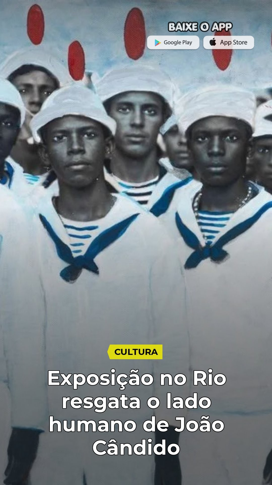

# Modo ensaio: redes sociais do Áfricas Play

Nada aqui foi publicado. As matérias mais novas ficam em cima.
Ordem das imagens: capa (arte do site), destaque, app e story.

<!-- inicio -->

## Exposição no Rio resgata o lado humano de João Cândido

*Cultura · robô, nota 8 · 22/11 13:19*

   

**Legenda do Instagram:**

> Exposição no Rio mostra o lado humano de João Cândido, líder da Revolta da Chibata, na Gamboa.
> 
> A mostra João Cândido, Mestre Sala dos Mares, no Instituto Pretos Novos, reúne 11 obras da artista Fátima Farkas. Em vez de só o herói da revolta, o público encontra o homem sensível, que bordava nos momentos de reclusão.
> 
> A artista mostra que a luta do Almirante Negro também tinha caráter trabalhista e nasceu de um gesto de empatia. A curadoria destaca a delicadeza dele, pouco contada pela história oficial.
> 
> 👉🏿 Quer ler a matéria completa? Comente APP que a gente te manda o link no direct.
> 
> Texto: Thays Andrade | Áfricas Play
> 📸 Foto: Guilherme Vendrame/Divulgação
> 
> #ÁfricasPlay #JoãoCândido #RevoltaDaChibata #ExposiçãoRJ #Gamboa

[Ver legendas do Facebook e textos alternativos](2026-11-22/1410-exposicao-no-rio-resgata-o-lado-humano-de-joao-candido/legendas.txt) · [Matéria no site](https://www.africas.com.br/noticia/exposicao-no-rio-resgata-o-lado-humano-de-joao-candido)

---

## Yung Peachie estreia Brasil Grime Show Apresenta

*Cultura · robô, nota 8 · 21/11 18:39*

   

**Legenda do Instagram:**

> Yung Peachie é a primeira artista convidada do novo formato do Brasil Grime Show, que lançou o trabalho "Brasil Grime Show Apresenta: Yung Peachie" nas plataformas digitais.
> 
> O formato aposta em showcases ao vivo que aproximam artistas e público, indo além das tradicionais sessões de grime. A performance, a personalidade artística e a troca com quem assiste ficam no centro da proposta.
> 
> A relação da artista com o projeto começou em 2025, numa Grime Session em uma Roda Cultural. Para quem acompanha a música urbana e a representatividade queer, a trajetória dela tem muito a dizer.
> 
> 👉🏿 Quer ler a matéria completa? Comente APP que a gente te manda o link no direct.
> 
> Texto: Thays Andrade | Áfricas Play
> 📸 Foto: @murabak_
> 
> #ÁfricasPlay #YungPeachie #BrasilGrimeShow #GrimeBrasil #MusicaUrbana

[Ver legendas do Facebook e textos alternativos](2026-11-22/1410-yung-peachie-estreia-brasil-grime-show-apresenta/legendas.txt) · [Matéria no site](https://www.africas.com.br/noticia/yung-peachie-estreia-brasil-grime-show-apresenta)

---

## Exposição no Rio resgata o lado humano de João Cândido

*Cultura · robô, nota 8 · 22/11 13:19*

   

**Legenda do Instagram:**

> Exposição no Rio mostra o lado humano de João Cândido, o Almirante Negro, no Instituto Pretos Novos, na Gamboa, com entrada gratuita até 23 de janeiro de 2027.
> 
> A mostra reúne 11 obras da artista Fátima Farkas, com pinturas, fotografias, colagens, bordados e instalações. Inaugurada às vésperas do Dia Nacional de Zumbi e da Consciência Negra, ela trata da Revolta da Chibata, levante de 22 a 27 de novembro de 1910 contra os castigos físicos na Marinha do Brasil.
> 
> Segundo a artista, a revolta nasceu de um gesto de empatia, quando um marinheiro foi punido com 300 chibatadas. Para o curador Jill Soares, a exposição foge do arquétipo de guerreiro e revela a delicadeza de João Cândido nos bordados que ele fez durante a reclusão. A visão rompe com a história oficial, que pouco destacou essa face.
> 
> O IPN fica na Gamboa, no coração da Pequena África, onde funcionou um cemitério de africanos recém-chegados ao país para serem escravizados. Visitação de terça a sexta, das 10h às 16h, e aos sábados, das 10h às 13h, na Rua Pedro Ernesto, 32.
> 
> Quer ler a matéria completa? Comente APP que a gente te manda o link no direct.
> 
> #ÁfricasPlay #JoãoCândido #RevoltaDaChibata #PequenaÁfrica
> 
> Foto: Guilherme Vendrame/Divulgação

[Ver legendas do Facebook e textos alternativos](2026-11-22/1356-exposicao-no-rio-resgata-o-lado-humano-de-joao-candido/legendas.txt) · [Matéria no site](https://www.africas.com.br/noticia/exposicao-no-rio-resgata-o-lado-humano-de-joao-candido)

---

## Yung Peachie estreia Brasil Grime Show Apresenta

*Cultura · robô, nota 8 · 21/11 18:39*

   

**Legenda do Instagram:**

> Yung Peachie é a primeira artista convidada do novo formato do Brasil Grime Show, com o lançamento "Brasil Grime Show Apresenta: Yung Peachie", já disponível em todas as plataformas digitais.
> 
> O trabalho é o primeiro do formato criado pelo projeto, com distribuição da MusicPRO. A proposta aposta em showcases ao vivo que aproximam artistas e público, indo além das tradicionais sessões de grime e colocando a performance, a personalidade artística e a troca com o público no centro da experiência.
> 
> A relação da artista com a plataforma começou em 2025, quando ela participou de uma Grime Session numa Roda Cultural. Criado em 2018, o Brasil Grime Show é referência na difusão da cultura grime e da música urbana no país. Peachie mistura samba, funk, charme, música eletrônica, rap e grime, com temas ligados à identidade, sexualidade e ocupação de espaços.
> 
> Quer ler a matéria completa? Comente APP que a gente te manda o link no direct.
> 
> #ÁfricasPlay #YungPeachie #BrasilGrimeShow #GrimeBrasil #MusicaUrbana
> 
> Foto: @murabak_

[Ver legendas do Facebook e textos alternativos](2026-11-22/1356-yung-peachie-estreia-brasil-grime-show-apresenta/legendas.txt) · [Matéria no site](https://www.africas.com.br/noticia/yung-peachie-estreia-brasil-grime-show-apresenta)

---

